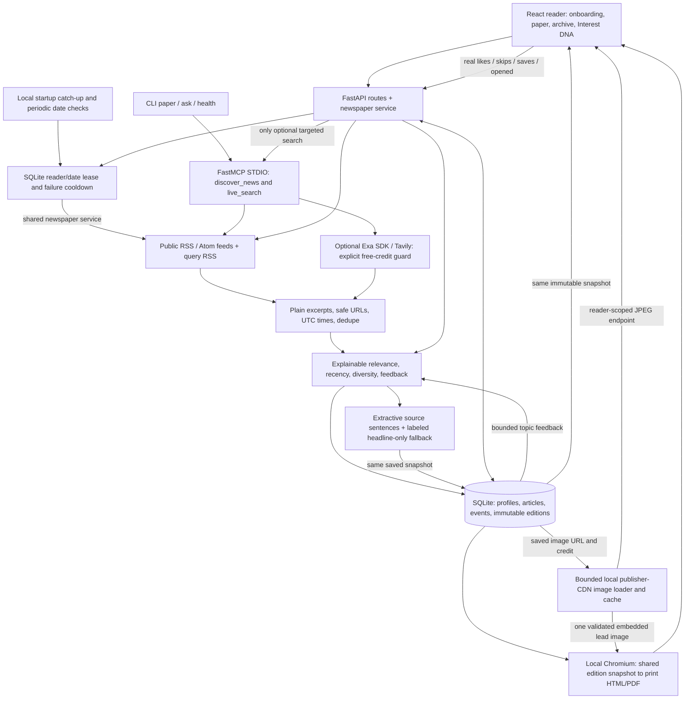

# The Daily Mind — architecture

The web pipeline calls public RSS directly: MCP is useful for an inspectable discovery
tool and targeted provider connector, not an artificial wrapper around every function.
`paper` CLI really invokes MCP STDIO; optional Exa search does too. Existing typed
`live_search` and `/api/v1/ask` remain functional under the zero-spend guard.

`backend/news/` separates models, ingestion, ranking, storage, service, routes and PDF.
SQLite is accessed with short parameterized transactions and WAL; no destructive
migrations. Reader IDs are random, stored in browser localStorage and passed as
X-Reader-ID. All profile/archive/events queries are scoped to that ID. This is intended
for a localhost demo, not public multi-user authentication.

Edition creation uses a per-reader lock and an atomic SQLite transaction; one saved
version per local date by default, explicit regeneration appends the next version.
Each edition contains complete article/provenance/rendering snapshots and profile/DNA
state. Web and PDF consume these, without independent search at render time. Interaction
topics come from the reader's edition snapshot, not a mutable global article document.

No LLM is needed. Priority points are deterministic, documented heuristic components;
known publication recency never substitutes retrieval time. Bounded feedback shows
observable score/rank changes, while diversity penalties reduce publisher repetition.

Custom interests use bounded phrase matching (AI does not match “said”). The ranking
feedback contribution uses the exact capped effective weights displayed by Interest DNA.
RSS candidate limits interleave feeds to avoid excluding later source categories.

`backend/news/memory.py` extracts actual source sentences/excerpts, prefers publisher
diversity and labels headline-only evidence when descriptions add no substantive text.
It performs no LLM paraphrasing or independent fact verification. Excerpts and evidence
links are saved in the immutable edition; both reader/PDF use the stored text. Legacy
editions retain legacy headline takeaways without migrations or refetching.

`personalization_proof.py` controls both profiles against one real captured RSS batch;
its optional replay is explicitly archived. `final_qa_browser.py` uses an isolated QA
database/server, verifies actual publisher navigation and compares snapshots across
real process restarts on OS-assigned ports. QA shutdown/ownership routes exist only in
scripts/qa_server.py and are ordered before its static mount; they are not production API.

Resource bounds: three RSS requests concurrently, two attempts max, connect/read and
overall per-feed deadlines, byte caps, per-feed/candidate limits, short-lived in-memory
cache. Failed live retrieval doesn't save an invented empty paper. Prior editions stay
readable. Local PDF jobs are serialized; print rendering blocks external requests.

Free-credit status cannot be proven from key presence, so credit search is off by default.
No payment, model, cloud hosting, account scraping or automatic submission workflow exists.

Daily scheduling runs in FastAPI's lifespan and is cancelled on graceful shutdown.
Automatic/manual generation share the service, per-reader lock and durable SQLite
lease. Existing editions return before retrieval. Failed work has a retry cooldown;
abandoned leases expire, and cancellation releases its claim. Bounded per-process
feed caches share responses between query interests and briefly cache feed failures.

Catch-up creates today's local date only. Persisted RSS within the configured maximum
retrieval age can create a labeled offline snapshot. Source times are unchanged; web
and PDF share its status, source-time range and warnings. Existing offline editions are
never silently upgraded. Use one worker for shared feed caching; no jobs run while off.

RSS normalization now extracts an optional best publisher image before stripping HTML
to an attributed description. Metadata survives Article JSON and immutable snapshots;
older editions are unchanged. Only URLs saved in a reader-owned article can reach the
image endpoint. The loader uses exact known publisher CDN hosts, public-address DNS
checks, no redirects or environment proxy, byte/pixel/time/concurrency bounds, verified
raster formats, metadata-free JPEG re-encoding, and bounded coalesced caching. Browser
images use authenticated-by-reader-header same-origin blobs, not third-party requests.
That header is still anonymous local data partitioning, not production authentication.
PDF embeds the validated lead JPEG; its Chromium browser still blocks remote requests.
Only metadata is persistent; in-memory image bytes are best effort and can disappear
on restart. A publisher may change or remove an asset without altering our saved text.
